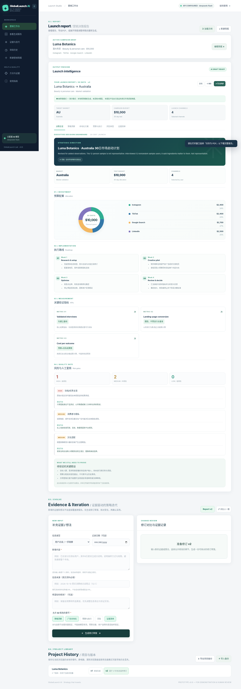
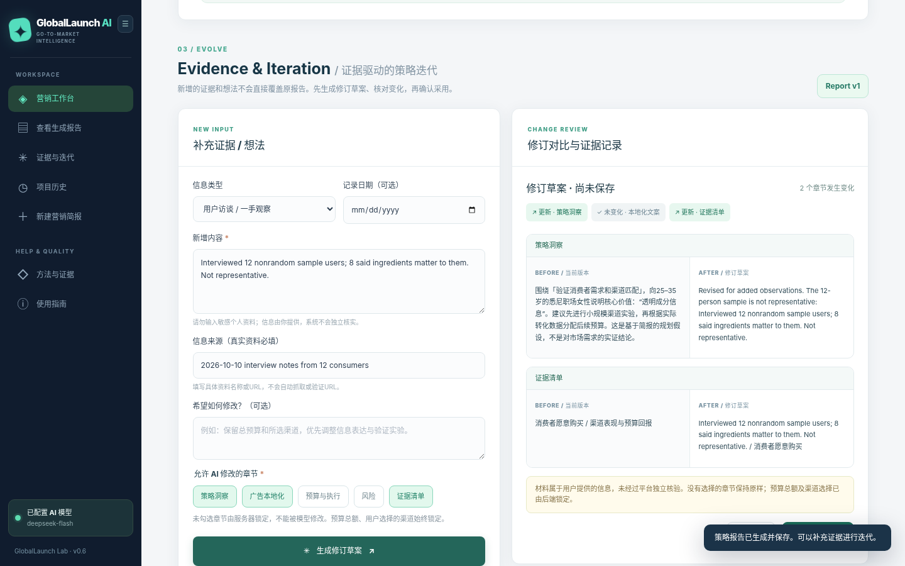

# GlobalLaunch AI | AI 跨境营销决策平台

**Evidence-Driven AI Cross-Border Marketing Decision Platform**  
**证据驱动的 AI 跨境营销决策平台 | 作品演示 / Portfolio MVP · v0.6**

[**Live Demo / 在线体验**](https://globallaunch-ai.onrender.com) · [**Bilingual Project Portfolio / 中英双语项目说明 (PDF)**](docs/GlobalLaunch_AI_BlueFocus_Portfolio_Bilingual.pdf)

> **演示提示 / Demo note**：在线网站部署于海外 Render，部分中国大陆网络可能无法稳定访问。可先阅读下方产品截图与 PDF。项目中的品牌、访谈及营销数据均为演示案例，不代表真实客户研究或效果验证。  
> Hosted on Render outside mainland China; access may be unreliable on some mainland Chinese networks. Screenshots and the PDF provide an alternative overview. Demo brands, interviews and campaign figures are illustrative, not independently validated customer research or results.

## 01 · 产品是什么 / What it does

**中文：** GlobalLaunch AI 面向跨境营销方案的早期规划与验证。用户输入品牌定位、目标市场、客户人群、预算和渠道，系统通过 DeepSeek API 生成结构化营销草稿；随后可以补充研究证据或新的想法，指定受影响章节，查看 AI 修订草稿与版本差异，并在人工确认后保存新版报告。

**English:** GlobalLaunch AI is an AI-assisted workspace for drafting and validating cross-border marketing strategies. Users provide a brand brief, target market, audience, budget and channels. The application produces a structured strategy draft via the DeepSeek API. Users can then add new observations or ideas, revise selected sections, inspect changes, and approve a new report version.

### 核心功能 / Core capabilities

- **Strategy generation / 策略生成：** positioning, localised advertising copy, channel budget, four-week plan, KPI definitions and risk review / 品牌定位、本地化文案、渠道预算、四周计划、KPI 与风险检查。
- **Evidence & iteration / 证据迭代：** add observations with source details; draft targeted revisions without silently overwriting the prior report / 记录来源、按章节修订、不自动覆盖旧版。
- **Version comparison / 版本对比：** review and approve v1 → v2 changes; retain history in the current browser / 人工确认后保存新版、对比旧版。
- **Report delivery / 报告交付：** interactive dashboard, budget visualisation and Markdown/PDF export / 可视化仪表盘、预算展示及 Markdown/PDF 导出。

## 02 · 界面预览 / Product screenshots



*AI marketing dashboard / AI 营销决策工作台。示例画面，不代表经验证的市场数据。*



*Evidence & Iteration / 证据驱动修订。图中访谈信息属于模拟测试数据，不是真实访谈结果。*

## 03 · 90 秒体验路径 / Suggested quick walkthrough

1. Open the **Live Demo** and select **加载示例 / Load example**. / 打开在线产品并加载示例。
2. Generate a **30-day strategy draft** and view its budget, KPI and risk sections. / 生成 30 天策略草稿并查看预算、指标与风险。
3. Open **证据与迭代 / Evidence & Iteration**, add an explicitly *hypothetical* observation, and select the sections to revise. / 加入明确标记的模拟信息并选择需修订章节。
4. Review the proposed changes, approve a new version, then compare v1 with v2. / 审查修订草稿，确认保存并对比版本。
5. Export the report using the browser's **Print → Save as PDF** workflow. / 使用浏览器打印对话框另存 PDF。

## 04 · 技术架构 / Technical overview

- **Frontend / 前端：** HTML, CSS, vanilla JavaScript; responsive UI.
- **Backend / 后端：** Node.js HTTP server.
- **AI provider / 模型：** DeepSeek Responses API, server-side API key, structured outputs and input validation.
- **Deployment / 部署：** GitHub + Render Web Service.
- **Revision history / 历史记录：** browser localStorage with JSON export/import; no cloud account syncing.
- **Testing / 测试：** automated tests for generation, mock provider integration, budgeting, revision constraints and version history; additional browser/PDF checks used simulated data.

### Run locally / 本地运行

Requires Node.js 20+. / 需要 Node.js 20 或以上。

```bash
cp .env.example .env
# Edit .env locally and add your own DEEPSEEK_API_KEY. Never commit it.
npm start
```

Windows PowerShell: `Copy-Item .env.example .env`, then `notepad .env`, then `npm.cmd start`.

Open `http://127.0.0.1:3000`. If no provider key is configured, the project uses a clearly labelled local Demo Mode. / 无密钥时运行明确标识的本地演示模式。

## 05 · 责任边界 / Responsible use & limitations

- Generated reports are **drafts requiring human verification**; this tool does not independently verify market data or legal compliance. / AI 内容是待人工核查的草稿，不提供独立市场事实核验或法律合规结论。
- New evidence is **user-supplied and not independently authenticated**. Illustrative interviews in demo materials are simulated. / 新增证据由使用者提供，未经系统独立核验；演示访谈均为虚构测试材料。
- Report histories reside in the **current browser only**; clearing browser data may erase them. JSON export/import is provided for backup. / 历史记录只保存在当前浏览器，需通过 JSON 备份。
- This is a **portfolio MVP**, not a validated commercial product, proven campaign or ROI claim. / 本项目是招聘展示用 MVP，并非已验证商业产品或真实广告效果。
- AI-assisted coding tools were used in building and testing this prototype. / 开发与测试过程中使用了 AI 辅助编程工具。

---

**GlobalLaunch AI · v0.6 · Portfolio prototype / 招聘作品演示**  
[Live Demo](https://globallaunch-ai.onrender.com) · [Project PDF / 项目说明](docs/GlobalLaunch_AI_BlueFocus_Portfolio_Bilingual.pdf)
