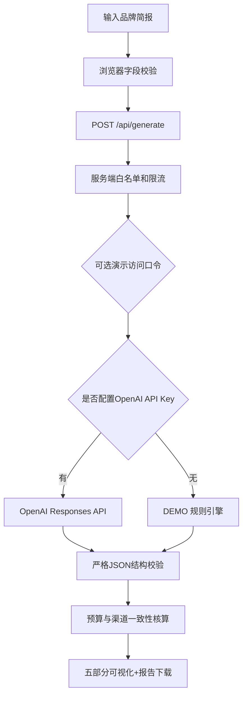

# GlobalLaunch AI v0.2 — 技术架构

## 组件

- **Frontend**：Vanilla JavaScript, HTML, CSS（响应式双栏，移动端单栏）；浏览器永不接触 OpenAI key。
- **Backend**：Node.js 原生 HTTP 服务器 + `fetch`，无外部运行时依赖。
- **Live AI engine**：OpenAI `POST /v1/responses`，`text.format` 为严格 JSON Schema。默认模型 `gpt-4.1-mini`。
- **Demo engine**：本地模板。仅 `OPENAI_API_KEY` 未配置时触发；若已配置密钥但调用失败，**不会静默降级并冒充AI结果**。
- **Schema module**：`lib/schema.mjs` 约束五个报告部分和各字段，`lib/validate.mjs` 对输入及核心输出做检验。
- **Budget normalization**：`lib/ai.mjs` 仅按用户选择的渠道计算份额；最大余数法确保比例100%、预算金额精确等于用户预算。
- **Storage**：不保存品牌简报、客户数据、用户账户或报告历史；只返回当前浏览器请求的草稿。

## 数据流

## 接口请求与数据安全

`POST /api/generate` 接收 `{brand,description,region,industry,audience,valueProp,goal,budget,channels,tone}`；只接受预设市场/行业/渠道与安全的文本长度/预算范围。

AI 调用体包含 `store:false`（不要求OpenAI保存可检索的响应状态），`instructions`（可信系统指令）、`input`（不可信用户简报）和 `text.format`（严格 schema）。没有启用任何自动网络搜索工具；AI不能声称它实时访问了市场研究数据。

应用有 CSP、HTML 转义、请求体上限、IP 速率限制、可选 `APP_ACCESS_CODE` 口令和进程内每日请求上限。后两项都不是生产级安全控制：生产环境应考虑持久化分布式限流、用户身份、审计和明确的云端预算控制。

### 失败与透明性

- 401/403、429、400、服务器错误：返回可读提示，不输出OpenAI返回的原始敏感错误详情。
- 请求超时：显示超时；不会以模板伪装真实生成。
- 模型拒绝、不完整、或JSON格式异常：明确报告错误。
- 页面 `API CONFIGURED` 只代表服务器检测到密钥；只有真实成功生成才有 `AI DRAFT READY`。

## 版本边界

MVP不含真实广告投放、竞品爬取、实时事实来源、法律核查、CRM、数据库、付费墙。建议在后续增加可验证的数据检索与来源记录、功能评估数据集、用户可编辑的方案、真正的线上A/B反馈闭环。市场分析的推断仍需当地消费者验证与团队审阅。

## v0.3 provider update — DeepSeek / OpenAI

Environment variable `AI_PROVIDER` chooses `deepseek` or `openai`. With `deepseek`, the backend calls DeepSeek Responses API using `DEEPSEEK_API_KEY` and `deepseek-flash`; with `openai`, it retains OpenAI Responses API compatibility. Both return the same application report schema. DeepSeek model requests use `reasoning.effort=none` to make short reports quicker; both require an API balance, and both are mocked in automated tests rather than live-charged. See `docs/DEEPSEEK-SETUP.md`.

## v0.4 presentation + print architecture

`public/report-view.mjs` is a pure, dependency-free view renderer. It receives the same `brief`, `meta`, and structured `report` JSON used by v0.3. It produces dashboard HTML (budgets, timeline, KPI, risks) and a separate full-print document with all sections. `public/app.js` switches tabs and invokes `window.print()` from a user-clicked PDF button. The browser creates PDF output after the user selects Save as PDF.

No model prompts, endpoints or secrets were added to the print path. Charts use CSS `conic-gradient`, with values derived from the server-reconciled budget. HTML is escaped before insertion. The original API/strict schema remains unchanged from v0.3. Unit tests verify rendering, totals and HTML escaping; Chromium preview/PDF checks verify browser output using simulated report data. A live DeepSeek call with the user's own key is required for end-to-end production verification.
